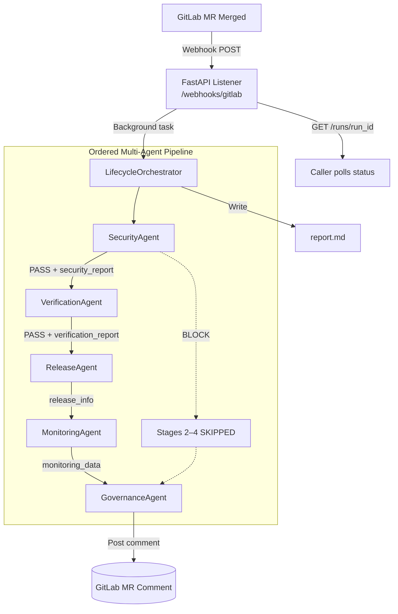

# Lifecycle Guardian

[](LICENSE)
[](https://www.python.org/downloads/)
[](https://fastapi.tiangolo.com)
[](https://gitlab.com)
[](#run-the-test-suite)

---

> ### An autonomous multi-agent system that owns the entire post-merge DevSecOps lifecycle — so your team doesn't have to.

When a GitLab Merge Request is merged, Lifecycle Guardian wakes up and runs five specialised AI agents in sequence: it scans for vulnerabilities, verifies tests and coverage, calculates the semantic version and publishes the release, configures post-deploy monitoring alerts, and seals a compliance audit — then posts a single authoritative report back to the MR. No manual steps. No fragmented scripts. No post-merge blindspot.

---

## Try It Now — No GitLab Account Needed

```bash
# 1. Clone
git clone <repo-url> lifecycle-guardian && cd lifecycle-guardian

# 2. Set up environment
python -m venv .venv
.venv\Scripts\activate        # Windows
# source .venv/bin/activate   # Linux / macOS

# 3. Install
pip install -r requirements.txt

# 4. Run the demo
python demo.py                # Clean merge — all gates pass, v1.3.0 released
python demo.py --blocked      # Critical CVE found — pipeline halted
```

The demo runs the full five-stage pipeline with realistic data, prints a live progress view, and saves the complete Markdown report to **`report.md`**.

---

## Why This Matters

The moment code lands in `main`, most teams lose coherent control:

| Without Lifecycle Guardian | With Lifecycle Guardian |
|:---|:---|
| Security scans run in CI but nobody acts on them | Security gate **blocks the release** on critical CVEs |
| Release tags created manually, inconsistently | SemVer bump inferred from MR title, tag created automatically |
| Monitoring set up ad-hoc after incidents | Post-deploy alert rules configured on every deploy |
| Compliance audits done quarterly in spreadsheets | Compliance notes sealed to the MR on every merge |
| Five different tools, five dashboards | One report, one place, every time |

Lifecycle Guardian replaces five disconnected manual processes with a single, event-driven multi-agent pipeline that runs in under one second.

---

## The Five DevSecOps Stages

Each stage is owned by a dedicated agent. Agents share state through a typed `LifecycleContext` object — upstream findings directly influence downstream decisions.

| # | Stage | Agent | Responsibility | Gates pipeline? |
|:-:|:------|:------|:--------------|:---------------:|
| 1 | **Secure** | `SecurityAgent` | Analyses SAST, DAST, Secret Scanning & Dependency findings. Calculates Risk Score (0–100) and issues a `pass`/`block` decision. Opens a GitLab issue on block. | Yes |
| 2 | **Verify** | `VerificationAgent` | Checks CI pipeline status, breaks down test suites (unit / integration / smoke), and validates coverage against the configured threshold. | Yes |
| 3 | **Release** | `ReleaseAgent` | Reads security + verification results before deciding. Infers SemVer bump from MR title prefix, generates changelog, tags and publishes the GitLab release. | — |
| 4 | **Monitor** | `MonitoringAgent` | Recommends monitoring focus areas, emits PromQL metrics with SLO thresholds, and defines P1/P2 alert rules with automated rollback actions. | — |
| 5 | **Govern** | `GovernanceAgent` | Synthesises an executive summary, compiles compliance notes (SOC 2, ISO 27001, OWASP Top 10), and posts the sealed audit report to the GitLab MR. **Always runs.** | — |

### How agents share context

```
SecurityAgent    writes → context.security_report     (risk_score, decision, findings)
VerificationAgent writes → context.verification_report (test_suites, coverage)
ReleaseAgent     writes → context.release_info         (tag_name, bump_type, notes)
MonitoringAgent  writes → context.monitoring_data      (telemetry, alerts, metrics)
GovernanceAgent  writes → context.governance_audit     (executive_summary, compliance)
```

The `ReleaseAgent` reads `security_report.decision` and `verification_report.coverage` before publishing. The `GovernanceAgent` reads all five fields to write its executive summary. No agent operates in isolation.

---

## Architecture



---

## Project Structure

```
lifecycle-guardian/
│
├── demo.py                        # One-command demo — start here
├── requirements.txt               # All Python dependencies
├── .env.example                   # Environment variable reference
├── LICENSE                        # MIT License
├── CONTRIBUTING.md                # How to contribute
│
├── src/
│   ├── config.py                  # Settings (Pydantic, .env support)
│   ├── main.py                    # FastAPI app + webhook + status API
│   │
│   ├── agents/
│   │   ├── base.py                # Abstract BaseAgent
│   │   ├── security_agent.py      # Stage 1 — Secure
│   │   ├── verification_agent.py  # Stage 2 — Verify
│   │   ├── release_agent.py       # Stage 3 — Release
│   │   ├── monitoring_agent.py    # Stage 4 — Monitor
│   │   └── governance_agent.py    # Stage 5 — Govern
│   │
│   └── core/
│       ├── orchestrator.py        # Pipeline runner + report generator
│       ├── state.py               # LifecycleContext, AgentResult, PipelineStatus
│       ├── events.py              # GitLab webhook schemas
│       └── gitlab_client.py       # GitLab API wrapper (dry-run safe)
│
└── tests/
    ├── test_agents.py             # 15 unit + integration tests
    └── run_tests.py               # Standalone runner (no pytest required)
```

---

## Getting Started

### Requirements

- Python **3.10** or higher
- No GitLab account needed for the demo or tests

### Installation

```bash
python -m venv .venv

# Windows
.venv\Scripts\activate

# Linux / macOS
source .venv/bin/activate

pip install -r requirements.txt
```

### Run the demo

```bash
python demo.py            # Scenario: clean merge, all gates pass
python demo.py --blocked  # Scenario: critical CVE blocks the pipeline
```

A full Markdown report is written to `report.md` after every run.

### Run the test suite

```bash
python tests/run_tests.py    # No pytest required
# — or —
pytest -v                    # With pytest
```

Expected result: **15 tests, 0 failures**.

### Start the API server

```bash
python -m src.main
# Swagger UI → http://localhost:8000/docs
```

---

## API Reference

| Method | Endpoint | Description |
|:-------|:---------|:------------|
| `GET` | `/health` | Liveness probe and agent config |
| `GET` | `/runs/{run_id}` | Poll run status; returns full `report.md` on completion |
| `POST` | `/webhooks/gitlab` | GitLab merge request webhook receiver |
| `POST` | `/runs/manual` | Trigger a run without a real webhook event |

#### Manual trigger example

```bash
python -m src.main &   # start server in background

curl -s -X POST http://localhost:8000/runs/manual \
  -H "Content-Type: application/json" \
  -d '{
    "project_id": 1001,
    "project_name": "payments-service",
    "mr_iid": 42,
    "mr_title": "feat(api): add rate limiting middleware",
    "target_branch": "main",
    "author_username": "dev"
  }'

# Then poll with the returned run_id:
curl http://localhost:8000/runs/lg-xxxxxxxx
```

---

## Connecting to GitLab

```bash
cp .env.example .env
# Edit: GITLAB_URL, GITLAB_PRIVATE_TOKEN, GITLAB_WEBHOOK_SECRET
```

In your GitLab project: **Settings → Webhooks**
- **URL**: `https://<your-host>/webhooks/gitlab`
- **Secret token**: matches `GITLAB_WEBHOOK_SECRET`
- **Trigger**: Merge request events

> `DRY_RUN=true` (the default) logs all GitLab API calls without making real changes. Safe to test against live projects.

---

## Sample Report Output

After `python demo.py`, open `report.md` to see the full report. Here is a preview:

```
╔══════════════════════════════════════════════════════════╗
║       LIFECYCLE GUARDIAN — PIPELINE PASSED               ║
╚══════════════════════════════════════════════════════════╝

## Run Metadata
| Run ID          | `lg-demo-passed`                              |
| Project         | `payments-service`                            |
| Merge Request   | !142 — feat(checkout): Stripe SCA 3DS2 flow   |
| Overall Status  | PASSED                                        |

## Executive Summary
> MR !142 by @sarah.chen passed all automated DevSecOps gates.
> Risk Score 5/100. 298 tests passed (94.6% coverage).
> Release v1.3.0 tagged and published on `main`.

## Pipeline Scorecard
| [PASSED] | Secure  | SecurityAgent      | PASSED | 0.00s |
| [PASSED] | Verify  | VerificationAgent  | PASSED | 0.00s |
| [PASSED] | Release | ReleaseAgent       | PASSED | 0.00s |
| [PASSED] | Monitor | MonitoringAgent    | PASSED | 0.00s |
| [PASSED] | Govern  | GovernanceAgent    | PASSED | 0.00s |

## Compliance Verification
| SOC 2 Type II | CC6.1 Logical Access | Compliant |
| ISO/IEC 27001 | A.12.6 Vulnerability | Compliant |
| OWASP Top 10  | A06:2021 Components  | Compliant |

## Final Recommendation
[PASSED] — All DevSecOps gates cleared. Release v1.3.0 is
live on `main`. Monitor post-deploy SLOs for 30 minutes.
```

---

## License

[MIT](LICENSE) — free to use, modify, and distribute.
